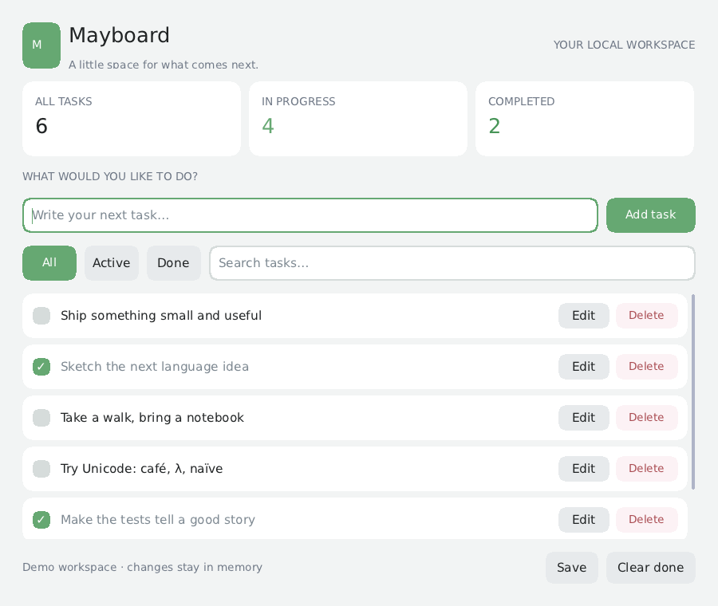

# Mayboard

A complete native desktop task board written in Maylang, using `stdlib/ui.may`.
Add tasks, edit titles, mark them complete, delete them, filter active/completed
tasks, search titles, and clear completed work. Stable IDs survive deletion and
reload. The app uses virtual rows for long lists and saves each mutation locally.



From an installed toolchain (or compile `toolchain/may/main.may` as `/tmp/may`
and set `MAYC` to the checkout's `mayc_new` launcher):

```sh
cd example_projects/apps/mayboard
may run
may test
may dev
```

Install `build-essential libx11-dev libxi-dev libxcursor-dev libgl-dev fonts-dejavu-core` on Debian/Ubuntu and run
under X11/XWayland with OpenGL 4.3 (including Mesa software rendering). The declared native prerequisite builds automatically.

```sh
may run -- --demo
may run -- --data /tmp/my-tasks.json
may run -- --demo --snapshot /tmp/mayboard.png
```

Default storage is `$XDG_DATA_HOME/mayboard/tasks.json`, falling back to
`~/.local/share/mayboard/tasks.json`. One interactive instance holds an exclusive task-file lock. Saves create private
temporary files, synchronize their contents, replace the data atomically, then
synchronize the containing directory. Invalid/corrupt source data is
preserved and the app shows a data-error message; repair the file and restart.
Save failures keep pending changes in memory and report an error with a Save
retry action. `--demo` changes stay in memory. `--snapshot` runs without a display.

Type a task and press Enter. Tab/Shift+Tab moves focus, Enter/Space activates an
action, and Ctrl+Q closes the window. Click Edit to focus the title editor;
Enter saves it and Cancel discards it. Search is an ASCII case-insensitive
substring match; Unicode task titles are preserved and edited by codepoint.

`src/model.may` owns task rules, `store.may` validates/serializes data, `view.may`
builds the responsive widget tree, and `main.may` applies UI actions. Model tests
cover valid/invalid edits, filters, IDs, serialization and bad records. The
[UI harness](../../../toolchain/mayui/tests/run.py) also tests real X11 input,
resize, close/reopen and corruption preservation using Xvfb and xdotool.
