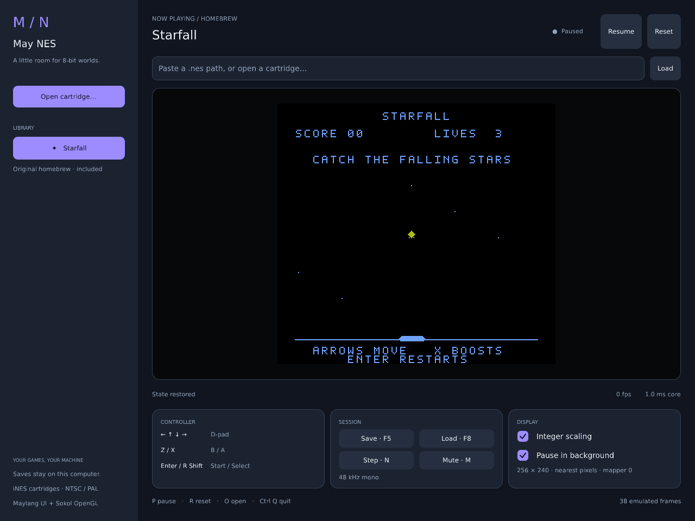

# May NES

A playable NES desktop app using Maylang's native UI and Sokol/OpenGL. The UI,
ROM library, settings, interaction and frame scheduling are Maylang; CPU, PPU,
APU and cartridge hardware come from the vendored MIT-licensed
[binjnes core](https://github.com/binji/binjnes). Builds work offline.



```sh
cd examples/apps/maynes
may run
may run -- --rom /path/to/game.nes
```

Starfall, an original small homebrew game, is embedded and starts immediately.
Catch stars with the paddle, hold X for a speed boost, and press Enter to start
again after losing three lives. The reproducible ROM and its MIT license are in
[roms](roms/); rebuild it with `python3 roms/build_demo.py`. No other games are
included.

Open a cartridge with **Open cartridge…**, or paste its path into the entry and
press Enter. Six recent cartridges and display/audio preferences persist between
runs. Failed loads keep the current game running. Integer scaling preserves
sharp pixels; turn it off to fit the available area. Resizing keeps the aspect
ratio. The app follows NTSC/PAL timing and pauses automatically in the background
by default, or while editing a path. The window remains responsive while paused.

| Key | Action |
| --- | --- |
| Arrow keys | D-pad |
| X / Z | A / B |
| Enter / right Shift | Start / Select |
| P / N | Pause or resume / step one frame |
| R / O / M | Reset / open cartridge / mute |
| F5 / F8 | Save / restore state |
| Ctrl Q | Quit |

The session buttons provide the same actions. Manual save states restore CPU,
PPU, mapper state and the currently displayed image, including while paused.
Each ROM has one state slot. Content-based filenames keep games with identical
contents together even if renamed. Battery SRAM is saved every five seconds,
when changing cartridges and on clean exit. Files are written through exclusive
temporary files, synchronized and atomically renamed. State envelopes verify
ROM identity, size and a checksum before restoring. Save states are local to
this build/architecture; they are not a cross-emulator interchange format.

Data lives in `$XDG_DATA_HOME/maynes`, or `~/.local/share/maynes`:

- `library.json`: recent paths and preferences.
- `<rom-content-hash>.sav`: battery-backed cartridge RAM.
- `<rom-content-hash>.state`: manual save state.

Requires the [native UI dependencies](../../../stdlib/ui/README.md). Audio uses
`libpulse-simple.so.0` at runtime and works with PulseAudio or PipeWire's Pulse
server; unavailable audio leaves the player usable. No audio development package
is required. The file picker uses `zenity`; the path entry works without it.

Cartridges must be **uncompressed iNES 1.0 `.nes` files**, up to 8 MiB. ZIP, NES
2.0, FDS, gamepads, a second controller and debugger tools are not implemented.
The core includes these mappers: 0, 1, 2, 3, 4, 5, 7, 9, 10, 11, 13, 16, 18,
19, 21–26, 28–30, 32–34, 38, 65–67, 69, 71, 75, 76, 78–80, 85, 87, 89, 93,
111, 118, 146, 163, 180, 206, 210 and 232. Support does not guarantee every game
or expansion-audio feature is accurate. Upstream provenance and local core fixes
are recorded in [native/vendor/README.md](native/vendor/README.md).

The GPU receives a 256×240 RGBA texture and renders it with nearest sampling in
the same alpha-blended batch as widgets and text. The dynamic texture and staging
buffer are reused. The Maylang loop uses a monotonic clock and a bounded catch-up
budget. The `ms core` readout measures emulation work, excluding UI construction,
presentation and GPU completion. The fps readout counts emulated frames per real
second. Audio IO runs on its own thread with a bounded queue.

```sh
may test
python3 tests/core.py
python3 tests/desktop.py
may run -- --headless --frames 180 --snapshot /tmp/maynes.png --report /tmp/maynes.json
```

`core.py` checks ROM admission, controller behavior, deterministic save/restore,
corruption rejection, persistence and SRAM, then repeats cartridge switching
under ASAN/UBSAN. `desktop.py` needs Xvfb and xdotool, drives an isolated native
window, reads actual GPU pixels, verifies pause/step/controller/save/load, loads
a path with spaces, checks recents and resizes. It never drives your desktop.
Both Python harnesses isolate their data in temporary directories. In a source
checkout, `desktop.py` selects the repository's stdlib; outside one it uses the
installed stdlib or `MAYLANG_STDLIB`.

For optional CPU validation, supply blargg's
[official_only.nes test ROM](https://github.com/christopherpow/nes-test-roms/tree/master/instr_test-v5):
`python3 tests/core.py --cpu-rom /path/to/official_only.nes`.
The ROM is not bundled. This integration passed all 16 of its test groups.
